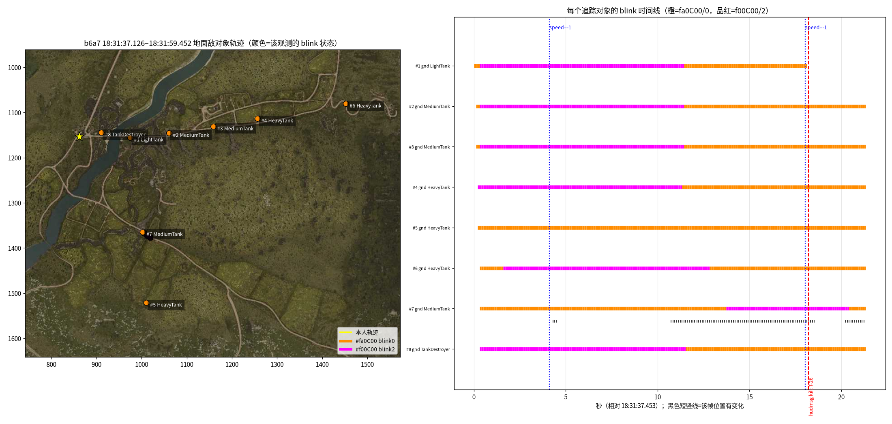
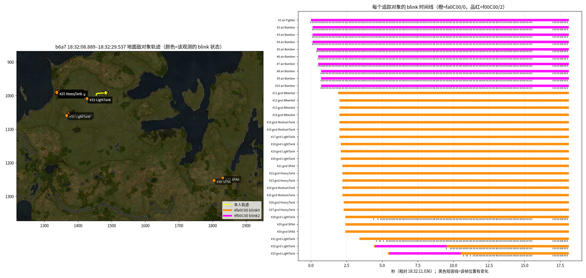

# 敌方地图标记（map_obj 红色对象）分析与解析模块（2026-10-10）

> 时间均为北京时间（UTC+8）。§0–§8 的数据：`/workspace/wt-collect/data/2026-10-10/` 全部 4 个会话（截至 18:56）。
> 脚本：`analyze_enemy.py`（结果 `enemy_results.json`）、`plot_enemy.py`（PNG）、模块 `enemy/`（截至 §9 共 29 个单元测试，全部通过）。

> **2026-10-10 21:00 更新：见 §9（带标注的实战数据）。** 重要修正：
> - 实战中敌方红标只有 `#fa0C00`/blink0 一种，且是实时跟踪；`#f00C00`/blink2 只在试车里出现。
> - 本人的命中和击毁、两次侦察标注，在 map_obj 里都**没有**对应的红标。
> - 下面 §0–§8 写于实战数据之前，其中关于 A/B 的假设以 §9 为准。

## 0. 结论速览

| # | 结论 | 级别 |
|---|---|---|
| 1 | **目前没有任何一段实战（RB）数据。**有对象的只有 2 段，都在会话 `b6a7`：陆战**试车** 18:31:37–18:31:59（Tiger H1，靶场）和空战**试飞** 18:32:09–18:32:30（Pucará，丹麦图）。`9bcb`、`5a10` 两个会话全部是 timeout（当时还在连 8111），`962f` 全程在机库。 | 已证实 |
| 2 | 所以 **(A) 队友侦察** 和 **(B) 被命中短暂暴露** 的字段差异，**现有数据无法给出任何结论**。下文关于 A/B 的内容都是假设，要靠 §6 的实测来验证。 | 已证实（没有数据） |
| 3 | 红色共 2 种色调，**色调和 blink 一一绑定**：`#fa0C00` (250,12,0) 一定是 blink 0，`#f00C00` (240,12,0) 一定是 blink 2。全部 7,531 次敌方红色观测中没有 `fa/2` 或 `f0/0`。blink 1 从未出现。 | 已证实（仅限试车/试飞） |
| 4 | 地面单位的 `#f00C00/2` 是**带固定计时器的临时高亮状态**： - 陆战试车 6 次完整高亮时长 11.13–11.23 s，另 1 次 6.70 s - 空战试飞 2 次时长 5.01 s / 4.99 s - 结束后**一律回到 `#fa0C00/0`**（2→0），没有一次是 2→消失 - 高亮期间位置不会冻结：移动靶 #7 在高亮期间 76% 的帧位置有更新 | 已证实（试车）；触发原因未知 |
| 5 | 敌机（aircraft）始终是 `#f00C00/2`，带 dx/dy，17–18 s 内从不切换，92% 的帧位置有更新。 | 已证实（试飞） |
| 6 | 被击毁的目标**下一帧就从 map_obj 消失**：T-26 在 18:31:55.579 最后一次出现，hudmsg 击毁消息在 55.657 到达，`/indicators.speed=-1` 的后坐力跳变在 55.486。消失前它是 `#fa0C00/0`，**命中/击毁本身不会触发 blink 2**。没有“残影/最后位置”对象，last-known 要靠客户端自己保留。 | 已证实（试车，n=1） |
| 7 | hudmsg 历史（以前的实战）里有一组**侦察相关的奖励**： - 给侦察车的“战场引导×N” - 给击杀者的“密接支援×N” 3/3 次都在队友击杀后 ≤1 s 内成对出现，获得“战场引导”的都是有侦察能力的车（M41A1、M18、鼬鼠 1A4）。 对应 Wiki 的 Intelligence / According to Intelligence 奖励。可以用它来锚定“被侦察目标被击毁”的时刻。 | 强推断（3/3） |
| 8 | 文档里**都没有** `#f00C00` 和 `#fa0C00` 的语义说明。blink 的说明只有“0 不闪、1 闪、2 强闪”这种渲染层描述，没有一份资料把它和侦察/命中联系起来。 | 已查证（§5） |

---

## 1. 片段判定（实战还是试车）

| 片段 | map_info | hudmsg（实时，不含 lastDmg=0 回放的历史） | 友军单位/帧 | 占领点/重生点 | mission.json | 判定 |
|---|---|---|---|---|---|---|
| b6a7 18:31:37.1–59.5 | gen 26，0..4096，hud_type 1，地图 dHash = `firing_range_tankmap` | 只有 1 条：“…（东线虎）击毁了 T-26”（受害者没有玩家名 → AI 靶车） | 0 | 无 | objectives null | **陆战试车** |
| b6a7 18:32:08.9–29.5 | gen 27，±65536，hud_type 0，`air_denmark_map` | 无 | 0 | 无（只有轰炸点、本方机场） | objectives null | **空战试飞** |
| 9bcb / 5a10 | 全部 timeout（端口 8111） | — | — | — | — | 没有数据 |
| 962f | `valid:false` | — | — | — | — | 机库 |

判定规则在 `enemy/stream.py: detect_session_kind`：

- 判为**实战**，满足任一条即可：
  - 有友军单位（蓝色或绿色、非 Player）
  - 有 capture_zone / respawn_base_*
  - 实时 hudmsg 里有 “X (载具) 击毁了 Y (载具)” 这种 PvP 句式
- 判为**试车**：以上都没有。

## 2. 变体字段对照（全部真实数据）

| 变体 | type | icon | color / color[] | blink | dx/dy | icon_bg | 观测次数（帧数）/ 轨迹数 | 持续时间 | 可见期间位置 | blink 转换 | 当前解释 |
|---|---|---|---|---|---|---|---|---|---|---|---|
| V1 敌地面·常态 | ground_model | LightTank / MediumTank / HeavyTank / TankDestroyer / Wheeled / SPAA | `#fa0C00` [250,12,0] | 0 | 无 | none | 陆战试车 928 / 8 轨迹；空战试飞 3,524 / 23 轨迹 | 从出现一直到片段结束（16–21 s），或到被击毁 | 实时更新：移动靶 75–80% 的帧有变化（#7 含停车 25%）；静止靶完全不变 | 初始状态；2→0 后回到这里；被击毁直接消失 | 试车：AI 靶车始终显示。RB：可能是“已知、未高亮”的显示状态（**待测**） |
| V2 敌地面·高亮 | ground_model | 同上（实际见到 Light/Medium/Heavy/TD） | `#f00C00` [240,12,0] | 2 | 无 | none | 陆战试车 729 / 7 轨迹；空战试飞 100 / 2 轨迹 | **11.13 / 11.13 / 11.13 / 11.13 / 11.22 / 11.23 s**（陆战）；6.70 s（陆战 #7）；**5.01 / 4.99 s**（空战） | #7 高亮期间 76% 的帧位置有更新（**不冻结**）；空战 #32/#33 高亮 5 s 内位置完全不变，结束后立刻开始移动（单位刚生成在原地停留，还是标记冻结，无法区分） | 0→2：出现后 0.1–1.3 s（#7 是 13.4 s 后）；2→0：计时到期。**没有 2→消失** | 临时“新发现/高亮”状态，有固定计时器。RB 中“被侦察/被命中短暂显示”很可能用这个状态（**假设**） |
| V3 敌机 | aircraft | Bomber / Fighter | `#f00C00` [240,12,0] | 2 | **有**（100%） | none | 1,782 / 10 轨迹 | 整段（17.4–18.1 s） | 92% 的帧有变化 | 从不切换 | 敌机一律用高亮样式（与 WTM 的 JH-7 夹具一致） |
| V4 轰炸点 | bombing_point | bombing_point | `#fa0C00` | 0 | 无 | none | 468（147 帧） | 18:32:14.5 起每 2 s 增加 1 个，共 4 个 | 静止 | — | 任务目标，不是单位（不进入跟踪） |
| 本人 | ground_model / aircraft | Player | `#faC81E` [250,200,30] | 0 | 有 | none | 379 | — | — | 空战出生时 `#043FFF` [4,63,255] **blink 2**，持续 2.0 s（11.84→13.83） | 说明 blink 2 是通用的“提示/闪烁”渲染状态（WTM：发出“注意地图”后，本人也会蓝闪约 5 s） |
| 友方机场 | airfield | none | `#174DFF` | 0 | sx/sy/ex/ey | none | 186 | — | — | — | — |

### 2.1 陆战试车逐目标时间线

“相对车体方位”= 目标方位 − 本人车体朝向（约 70°）。

| # | icon | 距离 | 相对车体方位 | blink 时间线 | 备注 |
|---|---|---|---|---|---|
| 8 | TankDestroyer | 99 m | +9° | 出现即 2（37.763）→ 48.984 变 0（**11.22 s**） | |
| 1 | LightTank（T-26） | 225 m | +21° | 0 → 37.763 变 2 → 48.892 变 0（11.13 s） | 55.579 被击毁后消失 |
| 2 | MediumTank | 398 m | +18° | 0 → 2（37.763）→ 0（48.892，11.13 s） | |
| 3 | MediumTank | 596 m | +16° | 同上（11.13 s） | |
| 4 | HeavyTank | 793 m | +14° | 出现即 2（37.655）→ 0（48.783，11.13 s） | |
| 6 | HeavyTank | 1,190 m | +13° | 0 → 39.051 变 2（**晚 1.3 s**）→ 0（50.284，11.23 s） | |
| 7 | MediumTank（移动靶） | 546 m | +75° | 0（13.4 s）→ 51.182 变 2 → 57.881 变 0（**6.70 s**） | 51.182 正好是本人开始起步（speed 0→1）的时刻 |
| 5 | HeavyTank | 793 m | **+88°** | **始终是 0** | |

规律：

- 车体正前方 ±21° 内的 6 个静止靶，在出生后 0.1–1.4 s 内进入高亮，并在约 11.1–11.2 s 后同时恢复。最远的 #6 晚了 1.3 s。
- 侧方 88° 的 #5 从未高亮。
- 侧方 75° 的移动靶 #7 在本人起步时才高亮，而且只持续了 6.7 s。

这符合“本车乘员视野内发现 → 闪烁若干秒”的假设，但 `/indicators` 没有炮塔/相机朝向，**无法证实**。另外空战试飞里，2 辆新生成的轻坦（#32 在 3.1 km、#33 在 3.0 km，比其他地面单位都近得多）出现 0.1 s 后高亮，正好 5.0 s；其余 7–28 km 外的单位从未高亮。说明“新生成/新发现 → 高亮 N 秒”这一规律在空战中也成立，N 依模式不同（陆战约 11 s，空战 5 s）。

图：`enemy_tracks_ground_testdrive.png`、`enemy_tracks_air_testflight.png`。左图为地图上的轨迹，橙色 = fa0C00/0，品红 = f00C00/2；右图为逐轨迹 blink 时间线，标出了位置变化帧、hudmsg 击毁和 speed=-1 后坐力。

### 2.2 与 hudmsg / indicators 的时间相关

| 事件 | 时刻 | 与地图对象的关系 |
|---|---|---|
| `/indicators.speed` 0→−1→0（静止开炮的后坐力） | 18:31:55.486 | 下一帧（55.579）是 T-26 的最后一次出现；之后 T-26 消失 |
| hudmsg id 1375 “…（东线虎）击毁了 T-26” | 18:31:55.657（hudmsg 2 Hz 轮询） | 在消失后 78 ms 到达 |
| `speed=-1` | 18:31:41.565 | 刹车回溜或开炮（无法区分）；地图对象没有任何变化 |
| 0→2 切换 | 37.66 / 37.76 / 39.05 / 51.18 | 附近没有 hudmsg，也没有开炮迹象 → **高亮不是命中触发的** |

陆战 `/indicators` 没有弹药计数（first_stage_ammo = −1），也没有开火标志。“玩家开火”只能用 speed 的 −1 跳变弱推断。**hudmsg 只报告击毁、起火、重创和致命攻击，不报告普通命中**，所以 B 类（命中暴露）不能完全靠 hudmsg 锚定。

## 3. 关于 A（侦察）和 B（命中暴露），现在能说什么

**能确定的（试车数据）：**

1. 红色地面单位只有 V1（fa0C00/0）和 V2（f00C00/2）两种表现；V2 有固定计时器，结束后回到 V1。
2. map_obj 中没有任何字段直接标注“被侦察”或“被命中”：`icon_bg` 恒为 none，没有额外键，地面单位没有 dx/dy。如果游戏在 RB 中区分 A/B，**只可能体现在**：
   - 颜色 / blink
   - 出现时长（A：Wiki 写明 30 s；B：“短暂”）
   - 位置是否更新（A：Wiki 写“周期性更新”；B：大概率冻结在命中时的位置）
   - 消失方式
3. 击毁会让对象立即消失，不会留下最后位置。

**假设（需要 §6 实测）：**

| 假设 | 判别特征 | 依据 |
|---|---|---|
| H-A1：被侦察的敌人以 V2（f00C00/2）出现，约 11 s 后转为 V1，总共可见约 30 s 后消失 | 可见时长 25–35 s；位置阶梯式更新（每隔 N 秒跳一次）或连续更新 | Wiki：RB 侦察 30 s、位置周期性更新；试车中 V2 计时约 11 s |
| H-B1：被命中暴露的敌人以 V2 出现，几秒后**直接消失**，位置冻结 | 可见时长 ≤ 15 s；位置变化 0 次；出现时刻在本人或队友开炮后 ≤ 1 s | Wiki RB：“nearby allies scout or hit → briefly displayed red icon” |
| H-B2：命中暴露只在 V1 出现（不闪） | 同上，但 blink 一直为 0 | 试车中击毁 T-26 时没有任何闪烁 |
| H-C：RB 中敌机也只在被发现后出现 | 敌机可见区间 | 未知 |

**无法回答：**

- 两种红色是否分别对应“侦察”和“命中”
- 侦察标记是否在 30 s 内跟随目标移动
- 命中暴露的时长
- 同一目标先被命中、再被侦察时如何表现

## 4. 解析模块 `enemy/`

- **输入**：map_obj 帧流 + map_info + 本人对象；可选 hudmsg 事件。
- **输出**：`Contact` 列表，以及 `ThreatSummary`。

`Contact` 字段：

- 身份：`contact_id`
- 时间：`first_seen_ms` / `last_seen_ms`
- 揭示类型：`reveal_kind`（scouted | hit_revealed | visible_static | unknown）+ `reveal_rule` + `reveal_confidence`
- 类别：`cls`（由 icon 得出）
- 原始状态：`color` / `rgb` / `blink`，以及 `blink_seq`（转换序列）
- 位置：归一化 `x,y`；世界坐标 `wx,wy`（world = map_min + norm × size，y 向下）
- 运动：`heading_deg`（仅 dx/dy 存在时）；`vel_mps` / `speed_mps` / `course_deg`（3 s 窗口位移）
- 状态：`visible` / `stale` / `age_ms` / `visible_spans`
- 相对本人：`distance_m`、`bearing_deg`（compass = atan2(east, −south)，与 heading = atan2(dx,−dy) 一致）

`ThreatSummary` 字段：8 扇区计数（全部 / 仅可见）、最近威胁（id、距离、方位、扇区）、主方向扇区。

跟踪器要点：

- 关联键：(type, icon)，不含颜色（同一目标会换色）
- 门限：25 m + vmax × 距“位置最后一次变化”的时间（地面 35 m/s，空中 450 m/s）
- 分配：全局贪心
- 生命周期：丢失 400 ms 后转为 stale（保留最后位置）；5 s 内可以重新捕获；60 s 后清除
- 排除：海军 icon、Player、轰炸点、机场

`reveal_kind` 规则（`reveal.py`，按顺序匹配）：

| 规则 | 条件 | 结果 | 置信度 |
|---|---|---|---|
| R0 | 飞机 | unknown | 0.3 |
| R1 | 试车，地面目标 | visible_static | 0.9；出现过 blink 2 的为 0.7 |
| R1s | 消失前后 ±1.5 s 内出现 hudmsg“战场引导/密接支援” | scouted | 0.75 |
| R2 | 首次出现前 1.5 s 到后 2.5 s 内有 hudmsg 击毁/起火/重创/致命，且可见时长 ≤ 15 s | hit_revealed | 0.6（涉及本人）/ 0.5 |
| R3 | 首段可见时长 20–40 s | scouted | 0.55；有阶梯式更新再 +0.15 |
| R4 | 首段可见时长 ≤ 15 s | hit_revealed | 0.5（位置不变）/ 0.35 |
| R5 | 可见 > 45 s | visible_static | 0.5 |
| R9 | 以上都不满足 | unknown | 0 |

这些阈值等 §6 的实测数据到手后再标定。

在本次数据上的结果：陆战 8 个目标全部为 visible_static（R1/R1b）；空战 23 个地面目标为 visible_static，10 架敌机为 unknown（R0）。

单元测试：23 个，全部通过。覆盖范围：

- 录制夹具：8 个目标没有重复轨迹；换色后身份不变；色调与 blink 绑定；T-26 消失时刻与击毁消息相关；移动靶测速；TD 距离 94 m、方位 79.6°；E 扇区为主方向；本人朝向约 70°；空战敌机恒为 blink 2；空战两辆轻坦高亮 5 s
- 合成用例：间断后重新捕获；stale 标记；3 s 冻结后跳 40 m 仍为同一轨迹；同类目标不串轨；R2/R3/R1s 规则

## 5. 资料核查（blink、两种红色、侦察标记）

| 来源 | 内容 | 对本问题的意义 |
|---|---|---|
| War Thunder Wiki《Scouting》 https://wiki.warthunder.com/mechanics/238-scouting | RB：在双筒望远镜/瞄准镜下把准星放在目标上按侦察键 → 目标上方出现红色小箭头，“updates periodically”，小地图同步更新，持续 **30 s**；30 s 内其他人不能重复侦察；被侦察目标被友军击杀时，侦察者获得 Intelligence 奖励，击杀者获得 According to Intelligence 奖励 | A 类的时长和更新方式的先验；“战场引导/密接支援”很可能就是这两个奖励 |
| War Thunder Wiki《Realistic Battles》 https://wiki.warthunder.com/gamemode/realistic_battles | 地面 RB 中敌人不显示在小地图上，“only a red coloured icon is briefly displayed on the minimap when nearby allies scout or hit a vehicle” | 证实存在 A/B 两种机制；B 类为“短暂显示”；没有提到颜色区分 |
| 官方开发博客 “New opportunities for light vehicles” https://warthunder.com/en/news/5193-development-new-opportunities-for-light-vehicles-en | RB 侦察标记“will be updated for 30 seconds”；RB 侦察失败会进入冷却 | 同上 |
| 官方论坛 “Scouting Through Scout UAVs” https://forum.warthunder.com/t/scouting-through-scout-uavs/260991 | 成功侦察后的冷却：无无人机时 6 s；有无人机在空时 RB 18 s | 测试时要留出冷却时间 |
| 官方论坛 “Blinking Icons on Sim EC Map” https://forum.warthunder.com/t/question-blinking-icons-on-sim-ec-map/224750 | 玩家推测：目标闪烁表示正在遭受攻击（机场被打时会闪） | 闪烁 ≈ 提示/受攻击，属于渲染层含义；不涉及 8111 字段 |
| Steam 讨论 https://steamcommunity.com/app/236390/discussions/0/1836811737987257639/ | RB 中屏幕边缘的 chevron 出现在队友命中敌人的位置附近，是近似位置 | B 类是近似位置，暗示冻结 |
| lucasvmx/WarThunder-localhost-documentation `openapi.yaml`、`MapObjects.md` | 只写了 “blink: Object blinking indicator”，示例全为 0；颜色是旧调色板（敌 `#fa3200`） | 没有语义说明 |
| WT-8111-Neo `WT_8111_API_REFERENCE.md` §Common Fields | “0 no blink, 1 normal blink, 2 heavy blink” | 只是渲染描述，没有证据来源 |
| wt-modern-8111 `docs/localhost-8111-api.md` | 观察到 blink 0/1/2；“注意地图”后本人蓝闪约 5 s；建议按“出现前 / 出现后 / 丢失后”采集对比（Contact-visibility verification）；隐藏对象被省略，不推断不可见目标；`objects.ts` 对 blink≠0 的敌方地面单位画虚线环 | 与我们“blink 2 = 提示态”的观察一致；没有侦察/命中的语义 |
| WTDashboard `wtdb/unit_tracker.py` | 按颜色、类型和归一化距离 0.08 关联；连续 3 帧未见才判为消失；保留 30 s 的“lost”残影并按惯性外推；**完全不使用 blink** | last-known 是客户端自己实现的，游戏不提供 |
| link18 `web/dashboard.js`、`rendering.py` | blink 只用于渲染闪烁；`isFriendlyColor` 只把 fa0c00/ff7e7e/ff0000 判为敌 → **会把 `#f00C00` 误判为友军** | 移植时不要沿用 |
| War-Thunder-Tactical-Map `MapCanvas.tsx` | blink 作为布尔值做透明度动画 | 没有语义说明 |
| 0corexpsx/War-Thunder-Intelligent-UI（GitHub README） | “Ghost markers”：被发现的敌人消失后，在最后位置保留 45 s 渐隐标记 | 同样由客户端实现 |

结论：**没有任何公开资料说明 `#f00C00` 与 `#fa0C00` 的区别，也没有资料说明 blink 2 与侦察/命中的关系**。官方只给出了游戏机制层面的描述（侦察 30 s 周期更新、命中短暂显示）。

## 6. 实测方案（RB 陆战，拿到决定性样本）

**准备：**

1. 采集器升到最新版，运行 `/rate 20`，把 map_obj、indicators、state 提到 20 Hz（加载时 3 s 的卡顿可以接受）。hudmsg 保持 2 Hz 即可。
2. 开 OBS/ShadowPlay 录屏，画面要包含小地图，并叠加 Windows 系统时钟（OBS“文本(GDI+)”读取本地时间，或在屏幕角落显示秒级时钟）。**录像是唯一的地面真值**：哪个图标何时出现、是否闪、是否跟着动。
3. 时间标记有两种方式，选一种：
   - 在采集器窗口输入备注后回车（会写入 `#note`）；
   - 在**小队频道**发短消息（例如 `m1`），会出现在 `/gamechat` 里，有时间戳，并且不用切出游戏。

**测试 A：侦察**（与一名会开侦察车的小队队友配合，正常对局中进行）

1. 自己开普通车，与队友约好：他侦察时在小队频道发 `S`，或者自己看到侦察提示时发 `A1`。
2. 每次侦察后，**不要攻击该目标**，盯住小地图 35 s，记录：
   - 图标第一次出现的时刻
   - 是否闪烁
   - 是否随目标移动（跳动还是连续）
   - 何时消失
3. 至少做 3 次。其中 1 次尽量选**移动中的目标**（区分“周期性更新”和“冻结”）。如果能做到，再选 1 次在 30 s 内被队友击毁的目标，验证 hudmsg 里“战场引导/密接支援”的时刻和图标消失是否一致。
4. 冷却时间：无无人机时 6 s，有无人机在空时 18 s。同一目标 30 s 内不能重复侦察。

**测试 B：命中暴露**

1. 自己命中一个**未被侦察、此前不在小地图上的**敌人，最好是非致命命中（打履带或侧裙）。开炮后立刻在小队频道发 `H1`（或输入备注），然后看小地图 15 s。
2. 再做一次“队友命中、自己没有直视目标”的情况：看到附近队友交火时发 `T1`。
3. 记录图标出现的时刻、时长、是否闪、是否移动、消失方式。至少 3 次。

**测试 C：对照**

1. 静止、没有任何交火 60 s，确认 map_obj 中没有红色地面单位（RB 基线）。
2. 敌机：有敌机出现在小地图上时发 `P1`。

**事后分析**（我来做）：`analyze_enemy.py` 已经会输出每条轨迹的以下信息，与录像和标记对齐后，即可确定 A/B 的字段差异并标定 `reveal.py` 的阈值：

- 出现和消失时刻
- 可见区间
- blink 时间线
- 位置变化率与最长静止时间
- 距离和方位

**判读要点：**

| 看什么 | A（侦察）预期 | B（命中）预期 |
|---|---|---|
| 可见时长 | 约 30 s | 几秒 |
| 位置 | 阶梯式更新（`max_static_s` 为数秒，变化次数 ≥ 2） | 冻结（变化次数 0） |
| blink / 色调 | 起始是否为 f00C00/2、约 11 s 后是否转为 fa0C00/0 | 是否始终 2 或始终 0 |
| 消失方式 | 时间到后消失 | 时间到后消失 |
| hudmsg 锚点 | 被击杀时出现“战场引导”+“密接支援” | 只有在致命/起火/重创时才有消息 |

**请同时记下：**

- 小地图上能看到的友军数量（实战中友军应为蓝色/绿色，在 map_obj 中可直接验证）
- 是否开启色盲模式
- 使用的车辆

## 7. 未决问题

1. RB 中 A/B 在字段上是否可以区分（颜色、blink、时长、位置更新）。
2. 陆战约 11 s、空战 5 s 的高亮计时器是什么含义：“被本车乘员发现”，还是“新生成”？#5（侧面 88°）从未高亮，#7 在本人起步时才高亮，倾向前者。
3. blink 1 何时出现（至今 0 次）。
4. 侦察标记在 30 s 内是否跟随目标；侦察和命中叠加时如何表现。
5. 色盲模式和小队绿色下的颜色。
6. “战场引导/密接支援”的英文对应关系需要用英文客户端核对（假设对应 Intelligence / According to Intelligence）。

## 8. 文件

- `ENEMY_MARKERS_20261010.md`（本报告）
- `enemy_results.json`（逐片段、逐轨迹的结果）
- `enemy_tracks_ground_testdrive.png`、`enemy_tracks_air_testflight.png`
- `analyze_enemy.py`、`plot_enemy.py`
- `enemy/`（模块、README、`tests/test_enemy.py`、`tests/fixtures/*.jsonl.gz`）

---

## 9. 【2026-10-10 晚 新增】带人工标注的实战数据（RB 陆战）

> 数据：HK 接收端 `/var/lib/wt-receiver/data/2026-10-10/`，会话 `20261010-193009-shengyuan-1709`（20:04–20:30，多局）和 `20261010-203023-shengyuan-df9b`（20:30–20:52，collector 0.2.0，GUI 标注按钮）。
> 时间一律用接收端同步后的 `ts_server_ms`，和 `#label.t_server` 同一时钟。标注时钟：`clock_synced=true`，offset 244.6 ms，RTT 188 ms。
> 局的划分（`battle_id`）：`e3:g35` = 20:38:20–20:42:37，用户说的“只有命中、没有侦察”那局；`e4:g36/g37` = 20:43:11–20:52，有两次侦察标注。g36→g37 是同一局里换乘飞机时 map_generation 加 1，不是新的一局。
> 夹具：`enemy/tests/fixtures/rb_df9b_*.jsonl.gz`，map_obj 只保留 ground_model/aircraft。新增 6 个测试，模块合计 29 个测试，全部通过。

### 9.1 标注一览（共 9 条）及 ±5 s 窗口

“hud 匹配”指 hudmsg 中和本人有关的对应事件。hudmsg 2 Hz 轮询，自身有 ±0.5 s 误差。

| # | 时间 | battle | 标注 | 送达 | ±5 s 内红色敌方标记 | ±5 s 内 hudmsg / 匹配 | 偏差 |
|---|---|---|---|---|---|---|---|
| 1 | 20:39:29.646 | g35 | got_hit 我被击中 | **late**，延迟 40.1 s | 无 | 没有本人受损的行（hudmsg 只播击毁、起火、致命、重创） | — |
| 2 | 20:39:35.278 | g35 | i_hit 我击中敌人 | late，34.4 s | 无 | Kod_giasa (PT-76) 击毁 Silikan97149 @35.1 | — |
| 3 | 20:39:39.160 | g35 | kill 击毁 | late，30.6 s | 无 | **本人没有击毁**；最近的是队友 Liamoooo 击毁 Kod_giasa (PT-76) @37.1 | −2.1 s（如果算协助） |
| 4 | 20:39:39.513 | g35 | died 阵亡 | late，30.2 s | 无 | **本人没有阵亡**：之后 Player 仍是黄色并在移动，本人实际阵亡在 20:42:30.45（ZSU-37） | 疑似误点 |
| 5 | 20:40:26.321 | g35 | i_hit | 0.1 s | 无（全帧 108 个敌方对象全是重生点/占领点） | 无 | — |
| 6 | 20:44:35.877 | g36 | kill | 0.5 s | 无 | 本人击毁 =DSHR= NEGERUNDAYO (M24) @32.597 | **+3.3 s** |
| 7 | 20:45:16.676 | g36 | kill | 0.1 s | 无 | 本人击毁 琢玉之人#1 (KV-85) @14.602 | **+2.1 s** |
| 8 | 20:45:44.677 | g36 | team_scouted 队友侦察 | 0.1 s | **无（±15 s 都没有）** | 本人 1.6 s 前（43.09）被 ФОБОС#1 (T-34-57) 击毁，标注时在击杀回放/阵亡画面；无侦察奖励 | — |
| 9 | 20:45:59.229 | g37 | team_scouted | 0.1 s | **无（±15 s 都没有）** | 本人刚出生在飞机上（Player aircraft @45:56）；无侦察奖励 | — |

标注质量：

- 实时送达的“击毁”标注比 hudmsg **晚 2–3.3 s**，是正常的人手反应。
- g35 的 4 条是批量补发（late=true，延迟 30–40 s），内容和 hudmsg 对不上：
  - kill 和 died 只隔 0.35 s；
  - 本人在 g35 的真实击毁（20:41:50.45，IS-2）和阵亡（20:42:30.45）都没有标。
- 没有标注的本人事件：
  - 击毁 211 工程 20:44:47.6、SU-100Y 20:45:34.6、ARL 44 20:48:56.1、KV-1 20:49:30.6；
  - 阵亡 20:45:43.1、20:50:22.1。

### 9.2 实战里所有红色敌方标记（两个会话合计约 40 分钟实战，只有 5 段）

| 会话 / gen | 时间 | icon | color / blink / dx,dy | 可见时长 | 位置更新 | 离本人 | 离最近队友 | 消失方式 |
|---|---|---|---|---|---|---|---|---|
| 1709 / 28 | 20:07:27.9–29.9 | MediumTank | `#fa0C00` / 0 / 无 | 2.0 s | 20/21 帧 | 433 m | 166 m | 超时 |
| 1709 / 28 | 20:07:56.8–20:08:38.0 | MediumTank | 同上 | 41.2 s | 400/413 | 433–455 m | 133–180 m | 超时（附近没有中坦被击毁的消息） |
| 1709 / 28 | 20:08:49.3–55.1 | MediumTank | 同上 | 5.8 s | 58/59 | 330 m | 111 m | 超时 |
| df9b / 37 | 20:50:00.8–15.6 | SPAA | 同上 | 14.8 s | 148/149 | 430–443 m | 158–174 m | 超时（可能是 Vendetta221 的 T-34 防空型，它 20:50:05 击毁了我方 TP_PendalfBY） |
| df9b / 37 | 20:50:18.6–39.4 | HeavyTank | 同上 | 20.8 s | 185/204 | 437–467 m | 53–131 m | **被击毁**：最后一帧 39.397，0.2 s 后 hudmsg 到达“Rache_Jagger69 (虎式 H1) 击毁了 x2ded#2 (KV-1)”（39.600）。击毁者是队友。 |

### 9.3 能下的结论

| # | 结论 | 级别 |
|---|---|---|
| R1 | **实战里敌方地面标记只有一种变体：`ground_model` + 车种 icon + `#fa0C00` (250,12,0) + blink 0 + 没有 dx/dy。** 两个会话所有实战帧里，`#f00C00` 和 blink 2 的敌方对象都是 0 次。所以 `#f00C00/blink2` 是试车/试飞（AI 靶）专用的高亮，和侦察、命中都无关。 | 已证实（5 段，约 1,000 次观测） |
| R2 | 实战里的红色标记是**实时跟踪**的：90–99 % 的 10 Hz 帧位置都在变，最长静止 ≤0.5 s。它们不是“冻结在最后位置”，也不是“隔几秒跳一次”。所以原先的假设 H-B1（命中暴露 = 冻结的最后位置）和 H-A1（侦察 = 周期性跳变）在这些标记上都不成立。 | 已证实 |
| R3 | 消失方式只有两种，map_obj 里**都不留残影**： - 被击毁时立即消失（KV-1：0.2 s 内） - 超时后直接消失 | 已证实（击毁 n=1，超时 n=4） |
| R4 | **本人的命中和击毁在 map_obj 里不产生任何敌方标记。** - 本人共有 16 次击毁地面目标（坦克里 12 次，飞机里 4 次），加上 2 条 i_hit 标注，前后 ±10 s 内一次红色标记都没有。 - 用户说的“只有命中”那局（g35，4 分 17 秒，自己 1 次击毁，队友多次击毁）整局 0 个红色标记。 所以从 8111 数据看，用户在屏幕上看到的“命中暴露”**没有导出到 /map_obj.json**。用户说“分不清是我打的还是队友打的”，在 map_obj 层面根本无从比较，因为两种情况都没有对象。 | 已证实（就本数据而言） |
| R5 | **侦察标记在 map_obj 里也没有出现：** - 两条 team_scouted 标注（20:45:44、20:45:59）±15 s 内都是 0 个红色对象。 - 1709 里 20:17:27 本人击毁 PT-76，同一秒 hudmsg 给了本人“密接支援×1”、给了队友 高级敞篷车驾驶员肯尼迪 (Sd.Kfz. 234/2) “战场引导×1”，说明这辆 PT-76 当时处于被侦察状态。可是 20:16:50–20:17:30 map_obj 里也没有它的红色标记。 | 已证实（n=3）；“侦察标记从不导出”是推断 |
| R6 | 那 5 段实时红色标记的成因**仍未确定**： - 可能是“附近队友正在交战或命中的敌人”：5 段都离队友 53–180 m、离本人 330–470 m；SPAA 段内它刚击毁了我方一辆车；KV-1 段以被队友击毁收尾。 - 也可能是某种别的侦察方式（例如友军飞机或无人机）。 仅靠字段**分不出 A/B**，两者字段完全相同。 | 假设 |
| R7 | 本人阵亡后的 Player 图标： - hudmsg 阵亡消息之后约 **7.3 s**（4 次：7.5、7.3、7.3、7.3 s），Player 从 `#faC81E` 变成 **`#174DFF`（友军蓝）**，持续 2.6–3.9 s 后消失，然后进入重生/换乘。 - 阵亡后最初约 7 s 里 Player 仍是黄色，map_obj 里看不出“已阵亡”。 - 一局结束时 Player 直接消失（20:42:30 阵亡 → 37.3 消失）。 - 7 次地面阵亡里，没有一次出现“击毁我的敌人”的标记。20:50:22 那次当时有一个红色 HeavyTank，但它是 20:50:39 被队友击毁的 KV-1；击毁我的 KV-122 在 20:50:46 还活着。 | 已证实 |
| R8 | 蓝色 `#043FFF` blink 2 = 该友军（或本人）刚发了一条无线电/快捷指令，和 /gamechat 一一对应： - 图标比 chat 早 0.1–0.4 s 出现 - “谢谢你！”这类持续约 2 s，“请求支援 / 注意战术地图”这类持续约 5–6 s - 20:08:53 本人发“谢谢你！”，自己的 Player 闪 2.0 s 这和敌方无关，但说明 **blink 2 在实战里就是“提示闪烁”**。 | 已证实（30+ 次） |

### 9.4 解析模块改动

- `stream.events`：
  - 改用 `ts_server_ms`（缺失时回退到 `wall_ms`）；
  - 新增 `('label', t, dict)` 事件，只用于分析，不作为跟踪器输入。
- `tracker`：
  - 记录 `player_seen_ms`。蓝色或缺失的 Player 不算“自己”，阵亡/观战期间保留最后一次的本人位置。
  - 标记失去可见时写入 `end_reason`：`timeout` / `player_gone` / `stream_end`。
- `reveal`：
  - 新增 `is_live_tracked()`（≥60 % 的帧位置有变化，且最长静止 ≤1.5 s）；
  - 新增 `end_reason()`：消失前 1.0 s 到消失后 1.5 s 内有击毁行，就记为 `killed` 并写入 `end_hud_id`；
  - 新规则 **R2k**：实时标记以队友击毁收尾 → `hit_revealed`，置信度 0.45；
  - 新规则 **R6**：实战里实时跟踪的 `#fa0C00/0` → `unknown`，置信度 0，明确写“侦察与命中不可分”；
  - 原来的 R3（20–40 s → 侦察）和 R4（≤15 s → 命中）只对非实时、周期跳变的标记生效。
- `Contact` 新增字段：`end_reason`、`end_hud_id`。
- 新测试：`TestRBLabelledBattle`（6 个）。

### 9.5 下一局怎么测侦察（要能分辨 A/B，必须先确认侦察到底有没有导出）

1. 自己开**有侦察能力的车**（M41A1 / M18 / 234 系列 / 鼬鼠等）亲自侦察，不要等队友：
   - 活着，停在原地；
   - 对着一个**已经看得见**的敌人按侦察键；
   - 听到或看到侦察成功的瞬间按 `i_scouted`。

   这样“侦察何时生效”不依赖队友，hudmsg 里也可能有对应奖励。
2. 侦察成功后**不要开火**，等 35 s，看小地图上的标记什么时候消失。消失的瞬间按 `note`，写“侦察标记消失”。
3. 同一局里另找一个敌人，**只打一发不击毁**，立刻按 `i_hit`。小地图出现红标、红标消失时各按一次 `enemy_icon`。
4. 有条件的话同时用 OBS 录屏（带小地图），哪怕只录 1 分钟，就能核对“屏幕上有标记、map_obj 里没有”。
5. 对照办法：
   - map_obj 在 ±5 s 内**仍没有红色对象** → 结论是 8111 不导出侦察和命中暴露，前端只能靠 hudmsg 和队友位置推断；
   - **有对象** → 比较它的 color/blink/时长/是否实时移动，和 §9.2 的 5 段是否相同。
6. 标注注意事项：
   - 活着的时候按；
   - 阵亡后的 7 s 回放、换乘画面里按的标注，不容易和 map_obj 对上；
   - 不要事后补按，g35 的 late 标注就对不上时间。

---

## 10. 【2026-10-10 21:15 新增】亲自侦察 + 亲自命中（battle `e5:g38`，21:07:49–21:12:30）

> 数据：同一会话 `df9b`，`battle_id …:e5:g38`。用户驾驶 **Sd.Kfz. 234/2（侦察车）**。
> 夹具：`enemy/tests/fixtures/rb_df9b_g38_iscout_ihit_note.jsonl.gz`，覆盖 21:09:27–21:12:22。新增 3 个测试，模块合计 32 个，全部通过。

### 10.1 标注（5 条，全部实时送达，延迟 0.1–0.5 s）及 ±20 s 窗口

| 时间 | 标注 | ±20 s 内红色敌方单位 | 相关 hudmsg / gamechat |
|---|---|---|---|
| 21:09:47.005 | i_scouted 我侦察到敌人 | **0** | 窗口内只有其他人的击毁和起火；**没有**“战场引导 / 密接支援”奖励 |
| 21:10:36.685 | died 阵亡 | 0 | 本人**并未阵亡**：Player 一直是黄色并在移动。按下前 1.4 s（35.300），队友 Terrastorm（四号 G）击毁了 -KISS- dgan9078 (M5A1)。推断这条标注是误点，紧接着按了 kill。 |
| 21:10:37.135 | kill 击毁 | 0 | 同上，按下前 1.8 s。dgan9078 就是被侦察的那辆车：它 21:10:11 击毁了我方 Willp0wer，又在 21:10:35 被我方 Terrastorm 击毁。距离 i_scouted **48.3 s** |
| 21:11:41.148 | i_hit 我击中敌人 | **0** | 本人的这次命中没有产生 hudmsg（只有致命、重创、起火、击毁才会出 hudmsg）。21:11:49.8 本人被 BB-1 引燃 |
| 21:12:02.096 | note “d”（命中标记消失；用户说比实际晚按 5–10 s） | 0 | 21:12:02.195 本人 Player 变成 `#043FFF` 闪烁，21:12:02.292 gamechat 出现本人的“注意战术地图！”。21:12:03.796 本人被 ⋇Ali_944-18 (M22) 击毁 |

### 10.2 结论

| # | 结论 | 级别 |
|---|---|---|
| S1 | 整局 2,990 帧 `/map_obj.json` 里，红色 `ground_model` / `aircraft` 一次都没有出现。 - 红色的只有静态对象：respawn_base、airfield、capture_zone，解析器本来就不跟踪它们。 - 自己侦察到的目标（M5A1，侦察后 48 s 被队友击毁）**一帧都没出现**。 - 自己命中后在屏幕小地图上看到的红标**一帧都没出现**。 | 已证实 |
| S2 | 结合 §9 的结论 R4、R5（本人 16 次击毁、2 次队友侦察标注、1 次带“密接支援”的被侦察目标，全部没有对象），可以确定：**8111 的 `/map_obj.json` 不导出侦察标记，也不导出命中暴露标记。** 因此“侦察和命中暴露在字段上有什么区别”这个问题在 8111 里不存在，两者都拿不到。 | 已证实（n=1 次亲自侦察 + 1 次亲自命中 + §9 的全部样本） |
| S3 | 屏幕上命中暴露的持续时间：i_hit → d 原始间隔 20.9 s；按用户说的“晚按 5–10 s”（放宽到 5–15 s）修正，**约 6–16 s，中值约 11 s**。这只来自人工观察，map_obj 无法测量。 | 估计（n=1） |
| S4 | 这次的被侦察目标被队友击毁时（侦察后 48 s），hudmsg **没有**给本人“战场引导”奖励。推测侦察效果已经超出约 30 s 的窗口。所以“战场引导 / 密接支援”只能证明“被侦察期间被击毁”，不能拿来反推每一次侦察。 | 推断 |
| S5 | §9.2 那 5 段实时红标的来源仍然不明。它们不是本人的侦察或命中，也没有任何一段对应已知的侦察。 | 未决 |
| S6 | 时间巧合：note “d” 按下后 0.1–0.2 s，游戏里出现了本人的“注意战术地图！”无线电（Player 闪烁 + gamechat）。可能是 GUI 按钮的热键和游戏按键冲突，也可能是用户同时按了游戏键。以后看到本人 `#043FFF` 闪烁和标注同时出现，要考虑这个因素。 | 观察 |

### 10.3 对前端 / 服务器的影响

- 敌方标记功能**不能指望 map_obj 提供侦察 / 命中暴露**。它只能拿到偶尔出现的实时红标（§9.2），这种红标的成因不明，解析器归为 `unknown`（规则 R6）。
- 需要的话，可以用这两类数据做弱推断（都不精确）：
  - hudmsg 的击毁、起火、致命消息，以及侦察奖励；
  - 本人和队友的位置。
- 解析器这次没有改规则，只在 `reveal.py` 的文档里补充了上面的证据，并新增了 3 个测试。如果以后出现了能对应到红标的侦察，再加规则。
