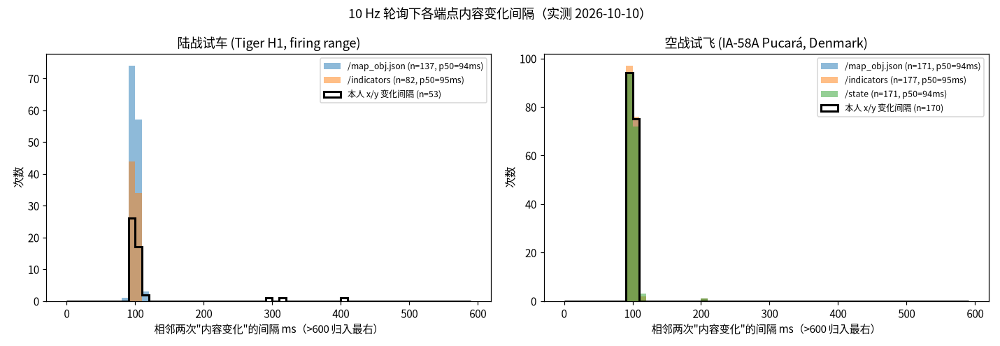
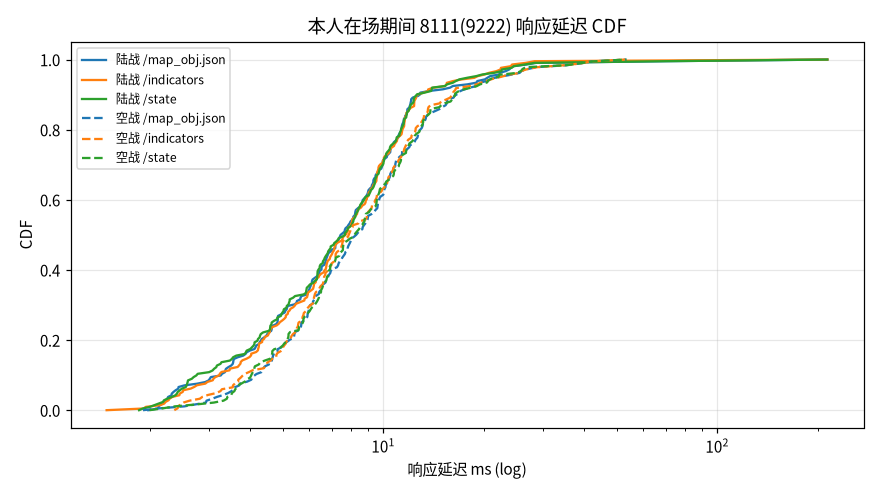
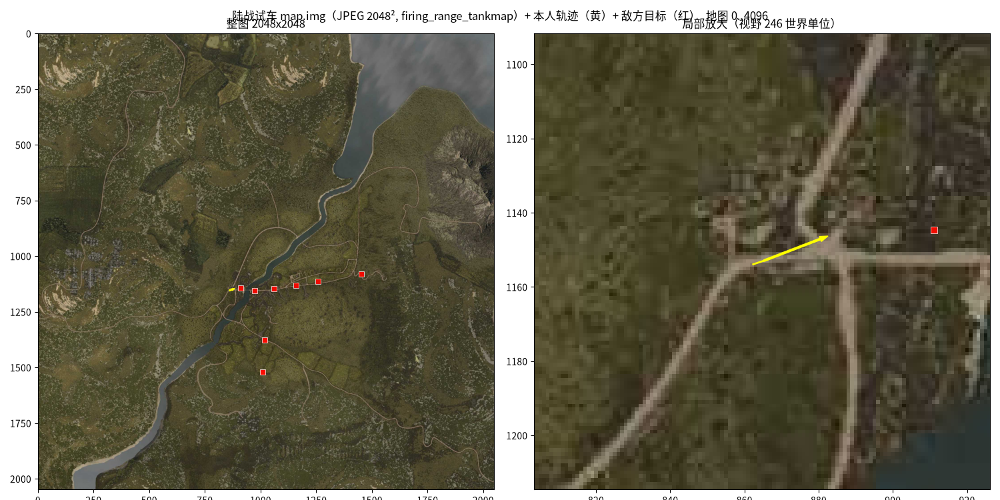
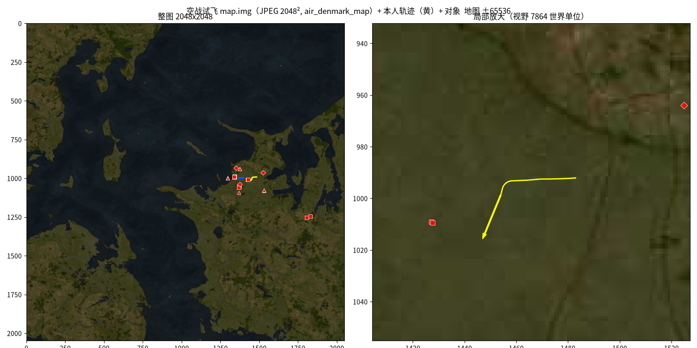

# War Thunder 本地 API 首批真实数据分析报告（2026-10-10）

> 数据来源：用户 Windows PC（主机名 `SHENGYUAN-ZHANG`）上的 wt-collector → 本机 wt-receiver。
> 所有时间均为北京时间（UTC+8）。原始数据未做任何修改；分析脚本与中间结果在 `/workspace/wt-analysis/`。
> 分析快照：会话 `b6a7` 截至 18:39:52（22,244 条记录，仍在实时采集）。18:32:29 之后用户一直在机库切换载具（PzH 2000 / Tiger H1 / Leopard I / IA-58），**没有新的对局片段**。

## 0. 一页结论

| # | 结论 | 与已有文档 |
|---|---|---|
| 1 | 这台 PC 上游戏 API 在 **9222 端口**，8111 拒绝连接（connect_refused, os error 10061）。所有硬编码 `127.0.0.1:8111` 的客户端（Neo、WTM、link18、WTP、TM、WTD）在这台机器上都会直接失效；只有 wp8f 默认轮换 `8111,9222`。 | **新发现**（与 wp8f 一致） |
| 2 | 9222 在 127.0.0.1 和 4 个局域网/虚拟网卡地址上都能访问 → 服务监听所有网卡（0.0.0.0）。 | 与 WTM 一致（0.0.0.0）；“关闭远程访问后是否只监听回环”**仍待测** |
| 3 | 两段试车都找到了：**陆战** 18:31:37.1–18:31:59.5（22.3 s，Tiger H1 东线虎，firing range 靶场）；**空战** 18:32:08.9–18:32:29.5（20.6 s，IA-58A Pucará，丹麦图）。 | — |
| 4 | 空战试飞的 map.img 是**真实地形图**（JPEG 2048×2048，202,995 B，dHash 匹配 WTP `air_denmark_map`，汉明距离 23），**不是** 128×128 占位图；占位图（PNG 128×128，1,519 B）只出现在机库/加载期间。 | 与 WTM（JH-7 试飞是占位图）**不一致**：取决于试飞地图 |
| 5 | 空战地图范围是 **±65536**（边长 131,072），不是文档写的 ±32768。grid 参数和 wp8f 的测试夹具逐字相同。 | 与 WTM/LVM **不一致**；与 wp8f/TM 一致 |
| 6 | 10 Hz 下飞行中 map_obj / indicators / state **每次都有新内容**（暂停外 100%）；陆战行驶中 100%，静止时 map_obj 55%、indicators 22%、state 0%（恒为 `{"valid": false}`）。 | 与 WTM 99/99 一致；陆战数据**新发现** |
| 7 | 延迟 p50 约 7.5–8.3 ms、p95 约 20–24 ms、p99 约 43–65 ms，比 WTM 的 3 ms 慢约 2.5 倍，但远小于 100 ms 轮询周期。 | 与 WTM **不一致**（偏慢，仍可用） |
| 8 | 空战朝向：`atan2(dx,-dy)` 和 `/indicators.compass` 比对 185 对，平均误差 0.0037°，p95 0.00005°，最大 0.36°（转弯中两次请求相差一帧）。陆战 `/indicators` **没有 compass 字段**；拿 dx/dy 和行驶轨迹方向比，中位误差 0.04°，最大 1.6°。 | 空战与 WTM 一致；陆战**新发现** |
| 9 | 调色板：本人 `#faC81E`；敌方地面 `#fa0C00`（blink 0），被高亮时变成 `#f00C00`（blink 2）；敌机始终是 `#f00C00` blink 2；友方机场 `#174DFF`；空战刚出生约 2 秒，本人显示为 `#043FFF` blink 2。link18 的 `isFriendlyColor` 会把 `#f00C00` 判成**友军**。 | 部分一致，部分**新发现**；link18 规则**不一致** |
| 10 | 每次进出地图，8111/9222 HTTP 都会**卡住约 3 秒**（所有端点 read_timeout）。另外约每 2 分钟出现一次 os error 10053（连接被中止，疑似 keep-alive 复用了失效连接）。 | **新发现** |

---

## 1. 数据与会话

| 会话 | 采集器 | 时间范围 | 记录数 | 内容 |
|---|---|---|---|---|
| `20261010-180048-shengyuan-962f` | 0.1.2 | 18:00:50.8 → 18:29:19.2（28.5 min） | 61,836 | 全程在机库（PzH 2000）：map_info `{"valid" : false}`，map_obj `[]`，state `{ "valid": false }` |
| `20261010-182921-shengyuan-b6a7` | 0.1.3 | 18:29:24.1 → 进行中（快照 18:39:52） | 22,244 | 升级备注 “upgrade to 0.1.3”；1 段陆战试车 + 1 段空战试飞 + 机库 |

两个会话的 `#meta` 都记录了端口自动探测结果，摘录如下：

```
127.0.0.1:8111       connect_refused (os error 10061)
127.0.0.1:9222       OK HTTP 200 11 ms valid=false   ← 选用
192.168.50.39:9222   OK   192.168.100.2:9222 OK   172.16.80.1:9222 OK   192.168.162.1:9222 OK
所有 *:8111          connect_refused
rates: indicators/map_obj/state 10 Hz, map_info/mission 1 Hz, hudmsg/gamechat 2 Hz, map.img 每 5 s 检查
```

内置分析器报告：`<session>/report/report.md`（两份都已重新生成）。本报告在此基础上用 Python 重新分析（`analyze.py`、`images.py`、`charts.py`）。

### 1.1 片段定位（map_info.valid=true 区间）

| 片段 | map_info valid=true | map_generation | hud_type | indicators | 本人对象（icon=Player）在场 |
|---|---|---|---|---|---|
| **陆战试车** | 18:31:37.126 → 18:31:58.457（下一个 valid=false 出现在 59.452） | 26 | 1 | army=tank，`tankModels/germ_pzkpfw_VI_ausf_h1_tiger_east` | 18:31:36.924 → 18:31:58.784，213 帧，type=ground_model |
| **空战试飞** | 18:32:08.889 → 18:32:28.545（下一个 valid=false 出现在 29.537） | 27 | 0 | army=air，`ia_58a_pucara` | 18:32:10.741 → 18:32:29.134，185 帧，type=aircraft |

**进出时序（DATA-04 的部分答案）：**

- **陆战**
  - 18:31:13.7 机库换车为 Tiger；indicators 先变为 `valid:false` 约 0.2 s，然后出现新的 type
  - 18:31:33.9 HTTP 全部卡住 3 s（加载）
  - 18:31:34.6 发出的 map.img 请求在约 37.45 返回真实地图
  - 18:31:36.9 Player 出现（map_obj 先于 map_info）
  - 18:31:37.126 map_info valid=true，gen 26，**但前约 1.3 s 的网格是临时值**（grid_size 4096、grid_steps 550、grid_zero [0,4096]）；18:31:38.46 才变为真实值（1600/225/[1519.45,2497.25]），map_generation 不变
- **退出陆战**
  - 18:31:58.88 Player 消失，同时 indicators 变为 `valid:false`
  - 18:31:59.45 map_info 变为 valid=false
  - 18:32:02.7 map.img 回到占位图（5 s 检查周期造成的滞后）
- **空战**
  - 18:32:02.97 机库选中 Pucará，此时 **state 已是 valid:true**
  - 18:32:05.1 HTTP 卡住 3 s
  - 18:32:07.7 map.img 变为丹麦图
  - 18:32:08.9 map_info valid=true，gen 27
  - 18:32:10.7 Player 出现（比 valid **晚 1.8 s**）
  - 18:32:11.8–13.7 本人为蓝色闪烁
  - 18:32:26.6–28.0 数据整体冻结约 1.4 s（疑似按 ESC 暂停）
  - 18:32:29.2 HTTP 卡住 3 s
  - 18:32:29.5 map_info 变为 valid=false
  - 18:32:30.9 map.img 回到占位图

---

## 2. 有效更新率、延迟、本人位置新鲜度（问题 1）

`新样本%` = 响应体与同端点上一个成功响应不同的比例。请求间隔中位数为 94 ms，原因是 Windows 默认计时器分辨率为 15.625 ms，间隔被量化成 6×（93.75 ms）或 7×（109.4 ms）；全会话平均间隔 103 ms（含卡顿）。



### 2.1 10 Hz 端点（片段内）

| 端点 | 片段 | n | 实际请求 Hz | 新样本% | 新样本 Hz | 行驶/飞行中 新样本% | 静止 新样本% | 内容变化间隔 p50 / p95 ms | 延迟 p50 / p95 / p99 ms |
|---|---|---|---|---|---|---|---|---|---|
| /map_obj.json | 陆战 | 214 | 9.59 | 64.5 | 6.18 | **100.0**（n=45）→ 约 9.6 Hz | **54.8**（n=168）→ 约 5.3 Hz | 94 / 110 | 7.50 / 21.4 / 64.5 |
| /indicators | 陆战 | 214 | 9.59 | 38.8 | 3.72 | **100.0** → 约 9.6 Hz | **21.6** → 约 2.1 Hz | 95 / 110 | 7.76 / 20.3 / 65.0 |
| /state | 陆战 | 214 | 9.59 | **0.0** | 0 | 0 | 0 | — | 7.67 / 19.3 / 64.1 |
| /map_obj.json | 空战 | 187 | 9.06 | 92.5（暂停外 **100**） | 8.33 | 92.4（含暂停）| — | 94 / 109 | 8.33 / 23.6 / 43.7 |
| /indicators | 空战 | 187 | 9.06 | 95.7（暂停外 **100**） | 8.62 | 95.7 | — | 95 / 109 | 7.89 / 23.4 / 43.6 |
| /state | 空战 | 187 | 9.06 | 92.5（暂停外 **100**） | 8.33 | 92.4 | — | 94 / 109 | 8.23 / 22.2 / 43.7 |

- 行驶/静止按同一 tick 的 `/indicators.speed` 判定（|speed| > 0.5）。陆战车速是**整数 km/h**（0, 1…10, −1）。整段只行驶了约 21% 的时间，累计位移约 6.4 世界单位（≈6 m），所以陆战的“行驶中”样本较少。
- 陆战静止时 map_obj 仍有 55% 的样本有变化，原因分解（166 对）：
  - 不变 76
  - 本人 dx/dy 微动 + 其他对象变化 60
  - 仅其他对象变化（敌方靶车闪烁状态切换、移动靶）16
  - 位置微动 9
- 陆战静止时 indicators 的变化来自 `rpm`（34 次）、`gear`（8 次）、`speed`（4 次）。
- 空战的 7.5% 未变化样本**全部**落在 18:32:26.6–28.0 的冻结期（疑似暂停）。暂停外 169/169 全部有新内容。所以游戏刷新率 **≥ 10 Hz**，真实上限要用 20 Hz 采样才能测出来。
- 片段边界上那一次 3 s 超时请求使 p99/max 偏高（陆战 max 2,980 ms）。片段内的稳态 p99 小于 65 ms。
- 机库（会话 962f，28.5 min，约 17k 次/端点）的延迟：map_obj 11.3 / 23.7 / 28.3 ms，indicators 9.3 / 22.9 / 27.2 ms，state 8.7 / 21.6 / 27.4 ms，0 超时。

### 2.2 其他端点（片段内）

| 端点 | 陆战 n / 新% / p50 / p95 ms | 空战 n / 新% / p50 / p95 ms | 说明 |
|---|---|---|---|
| /map_info.json（1 Hz） | 23 / 8.7 / 9.4 / 64.4 | 20 / 5.0 / 6.7 / 263 | 陆战有 2 次变化：valid 切换 + 临时网格变为真实网格 |
| /mission.json（1 Hz） | 23 / 0 / 9.6 / 64.5 | 18 / 0 / 6.3 / 16.2 | 恒为 running、objectives null |
| /hudmsg（2 Hz） | 40 / 10 / 7.5 / 28.3 | 38 / 5.3 / 7.3 / 20.5 | 见 §6 |
| /gamechat（2 Hz） | 45 / 0 / 8.6 / 60.7 | 36 / 0 / 7.4 / 19.2 | 恒为 `[]` |
| /map.img（每 5 s） | 5 次 + ?gen 1 次 / 11.5 / 35 | 4 次 + ?gen 1 次 / 7.8 / 23.5 | 每次都下载完整图片（50 万字节级） |

### 2.3 本人 x/y 新鲜度

| 片段 | Player 帧 | x/y 变化帧 | 变化% | 变化间隔 p50 / p95 / max ms | 行驶中 / 静止 变化% |
|---|---|---|---|---|---|
| 陆战 | 213 | 54 | 25.4 | 101 / 1,862 / 7,325（静止期间） | **97.8%**（44/45）/ **5.4%**（9/168） |
| 空战 | 185 | 171 | 92.4 | 94 / 109 / 1,502（暂停） | 92.4%（暂停外 100%） |

- 坐标保留 6 位小数：陆战地图（4096）的分辨率为 0.004 世界单位，空战地图（131,072）为 0.13 世界单位。
- 运动中每次轮询都能拿到新位置，没有观察到“游戏内部以低于 10 Hz 的频率刷新 map_obj”的迹象（内置网页只按 2 Hz 刷新，但接口本身不限速）。



---

## 3. map_info（问题 2）

| 字段 | 陆战（gen 26） | 空战（gen 27） |
|---|---|---|
| valid | true（bool） | true |
| hud_type | **1**（int） | **0**（int） |
| map_min / map_max | [0,0] / [4096,4096] | **[-65536,-65536] / [65536,65536]** |
| grid_size | 临时值 [4096,4096] → 真实值 [1600,1600] | [52719.398, 55385.301]（非正方形） |
| grid_steps | 临时值 [550,550] → 真实值 [225,225] | [5500,5500] |
| grid_zero | 临时值 [0,4096] → 真实值 [1519.449951171875, 2497.25] | [6494.30078125, 19547.5] |
| map_generation | 26（int） | 27（int） |
| 机库 / 加载 | `{"valid" : false}`（17 B，无其他字段） | 同左 |

- **类型：**所有数值都是 JSON number（float 数组、int），**没有出现 LVM 文档里的数字字符串格式**。
- **map_generation：**每次加载新地图加 1（26 → 27），不从 1 开始，说明是游戏启动以来的本地计数（用户此前打过几局）。它在机库/valid=false 期间不出现。临时网格变为真实网格时 **generation 不变**，所以客户端必须在每次 map_info 到达时更新网格，不能只在 generation 变化时更新。
- **陆战数值**与 Neo 文档示例逐字相同（grid_zero 1519.449951171875 / 2497.25）。Neo 的 map_obj 示例中本人位置 (0.421074, 0.563430) 也和我们本人出生点的第一帧完全一致，可见 **Neo 的“陆战实测样本”就是同一张试车靶场**。
- **空战数值**与 wp8f `core/src/parser/flat_json.rs` 的测试夹具逐字相同（grid_size 52719.39843750 / 55385.300781250，±65536）。
- `hud_type` 与 Player 类型一致：ground_model 对应 1，aircraft 对应 0。

---

## 4. map.img（问题 3）

| 用途 | sha256 | 格式 / 编码 | 分辨率 | 字节 | WTP dHash（16×15） | WTP 匹配 |
|---|---|---|---|---|---|---|
| 陆战试车 | `3a7d46abe5a817839c04c68c0dc7ce2578db441bea1ba0047a907dd794c8c33e` | JPEG（JFIF，RGB），Content-Type `image/jpeg` | **2048×2048** | 506,117 | `b695d193b62668987830e40638943cde73bce9b0d375a5b7474b1e268` | `firing_range_tankmap`，汉明距离 **20**（阈值 42），次近 90 |
| 空战试飞 | `7e6edd02c5ec91acd42917c3c60c4e588cd8823080860e86929aceae370bc45f` | JPEG（JFIF，RGB） | **2048×2048** | 202,995 | `666598db76360eece619d93226148d401a5488f0a76374c225c60d800` | `air_denmark_map`（✈️ Denmark），距离 **23**，次近 89 |
| 机库 / 加载占位图 | `cfb99c04947c94c19d4c523c1e0fb3a2d71d403263fefcad5f4c4fc8485d07d0` | PNG（RGBA），`image/png` | 128×128 | 1,519 | `0000048036008f002604e6061802600580034016800c0020001000000` | `no_map`，**精确匹配**（距离 0）；91.94% 像素为 `#404040` |

- **空战试飞拿到的是真实丹麦地图，不是占位图。**WTM 记录 JH-7 试飞返回占位图，说明是否返回占位图取决于试飞所用的地图，不能一概而论。
- 两张真实地图的 sha256 都**不在** WTP 的哈希表里（WTP 只存 dHash），但 dHash 在阈值内唯一命中，可以直接用于地图识别。
- `/map.img?gen=N` 与 `/map.img` 字节完全相同（2/2 次检查）。同一 generation 内图片不变（陆战 5 次、空战 4 次 sha 相同）。
- 机库全程（会话 962f 共 340 次，b6a7 机库期间也一样）返回占位 PNG。
- 已导出的 PNG：
  - `map_ground_3a7d46abe5a8.png`（陆战，2048²）
  - `map_air_7e6edd02c5ec.png`（空战，2048²）
  - `map_placeholder_cfb99c04947c.png`（占位图）
  - 叠加本人轨迹：`map_ground_track_overlay.png`、`map_air_track_overlay.png`




---

## 5. map_obj（问题 4）

### 5.1 对象清单（obs = 对象出现次数，跨帧累计）

**陆战试车（214 帧，每帧 0–9 个，平均 8.7；仅 1 帧为空，即 Player 出现前的第一帧）**

| type | icon | color | blink | obs | dx/dy |
|---|---|---|---|---|---|
| ground_model | Player | `#faC81E` (250,200,30) | 0 | 213 | 100% |
| ground_model | HeavyTank | `#fa0C00` (250,12,0) | 0 | 411 | 0 |
| ground_model | MediumTank | `#fa0C00` | 0 | 347 | 0 |
| ground_model | MediumTank | `#f00C00` (240,12,0) | 2 | 287 | 0 |
| ground_model | HeavyTank | `#f00C00` | 2 | 221 | 0 |
| ground_model | TankDestroyer | `#f00C00` | 2 | 111 | 0 |
| ground_model | LightTank | `#f00C00` | 2 | 110 | 0 |
| ground_model | TankDestroyer | `#fa0C00` | 0 | 99 | 0 |
| ground_model | LightTank | `#fa0C00` | 0 | 71 | 0 |

**空战试飞（186 帧，每帧 1–39 个，平均 33.6，无空帧；接收端另外剔除了 900 个海军对象，每帧 5 个）**

| type | icon | color | blink | obs | dx/dy |
|---|---|---|---|---|---|
| aircraft | Player | `#faC81E` | 0 | 165 | 100% |
| aircraft | Player | **`#043FFF` (4,63,255)** | **2** | 20（18:32:11.8–13.7） | 100% |
| aircraft | Bomber | `#f00C00` | 2 | 1,600（每帧最多 9 架） | 100% |
| aircraft | Fighter | `#f00C00` | 2 | 182 | 100% |
| ground_model | LightTank | `#fa0C00` | 0 | 1,117 | 0 |
| ground_model | LightTank | `#f00C00` | 2 | 100 | 0 |
| ground_model | Wheeled | `#fa0C00` | 0 | 649 | 0 |
| ground_model | MediumTank | `#fa0C00` | 0 | 644 | 0 |
| ground_model | HeavyTank | `#fa0C00` | 0 | 638 | 0 |
| ground_model | SPAA | `#fa0C00` | 0 | 476 | 0 |
| bombing_point | bombing_point | `#fa0C00` | 0 | 468 | 0 |
| airfield | none | `#174DFF` (23,77,255) | 0 | 186（sx/sy/ex/ey，无 x/y） | 0 |

- 海军对象已被接收端剔除（只保留计数）。值得注意的是它们的 `type` 是 **`ground_model`** 而不是 ship，icon 分别为 BattleShip/Boat/Destroyer/HeavyCruiser。所以判定海军必须看 icon，不能看 type。
- **新图标：`TankDestroyer`**（不在规范 §4.5 的已观察列表中）。
- 字段集合有三种：
  - 带朝向对象：`blink|color|color[]|dx|dy|icon|icon_bg|type|x|y`
  - 普通对象：`blink|color|color[]|icon|icon_bg|type|x|y`
  - 机场：`blink|color|color[]|ex|ey|icon|icon_bg|sx|sy|type`
- 所有对象都带 `color[]`，`icon_bg` 一律为 `none`。
- 没有出现 point_of_interest、capture_zone、respawn_base_*（试车模式下没有这些对象）。

### 5.2 Player 与 dx/dy

- 两种模式下都有 Player 对象（icon=="Player"），type 分别为 ground_model 和 aircraft。dx/dy 在 100% 的帧中存在，均为单位向量（模长 1 ± 6×10⁻⁷）。
- 非玩家地面单位**没有** dx/dy（0/5,281）；敌机**全部**有 dx/dy。

### 5.3 朝向精度

| 模式 | 参照 | n | 平均 \|误差\| | p95 | 最大 |
|---|---|---|---|---|---|
| 空战 | `/indicators.compass`（同一 tick，两次请求相隔 < 30 ms） | 185 | **0.0037°** | 0.00005° | 0.36°（转弯中两次请求相差一帧） |
| 空战 | 轨迹方位（≥ 1 s 位移） | 170 | 1.70°（中位 1.04°） | — | 7.5°（侧滑/转弯） |
| 陆战 | `/indicators` **没有 compass 字段**，无法直接比对 | — | — | — | — |
| 陆战 | 轨迹方位（≥ 1 s 且位移 > 1 单位） | 25 | 0.39°（中位 0.04°） | — | 1.6°；无倒车样本 |

陆战本人朝向在 69.0°–71.7° 之间，静止时也有微小抖动（213 帧中有 108 种不同的 dx/dy）。它与行驶方向一致，**很可能是车体朝向**；是否会随炮塔或相机转动，这次数据无法区分（仍待测）。

### 5.4 调色板

| 角色 | 颜色 | 观察 |
|---|---|---|
| 本人 | `#faC81E` (250,200,30) blink 0 | 陆空均是 |
| 本人（空战出生后约 2 s） | `#043FFF` (4,63,255) blink 2 | 20 帧，之后变回黄色；用户可能并未发出“注意地图” |
| 敌方地面 / 轰炸点 | `#fa0C00` (250,12,0) blink 0 | |
| 敌方高亮状态 | `#f00C00` (240,12,0) blink 2 | 陆战：出生后约 11 s（18:31:37.7 → 48.9）内多数靶车为此状态，之后陆续恢复为 fa0C00/0；同一对象会在两种颜色间切换。空战：所有敌机始终是此状态 |
| 友方机场 | `#174DFF` (23,77,255) | |
| 友军单位 / 小队绿色 | — | 试车没有友军，**未观察到** |

规范的判定规则（r≥200 且 g<130 且 b<130 → 敌）能覆盖 `#fa0C00` 和 `#f00C00`。link18 的 `isFriendlyColor` 只把 `#fa0c00` / `#ff7e7e` / `#ff0000` 视为敌，**会把 `#f00C00` 误判为友军**。Neo 的 `inferAffiliation`（r>180 且 g<90 且 b<90）判断正确。

---

## 6. indicators / state（问题 5）

| | 陆战（Tiger H1） | 空战（IA-58A） |
|---|---|---|
| /indicators 字段数 | 20 | 80 |
| 陆战字段 | valid, army, type, stabilizer(−1), gear, gear_neutral, speed（整数 km/h）, **has_speed_warning, driving_direction_mode, cruise_control**, lws(−1), ircm(−1), **roll_indicators_is_available**, first_stage_ammo(−1), crew_total=5, crew_current, **crew_distance**, gunner_state, driver_state | — |
| 空战字段 | — | speed, pedals/pedals1…8, stick_elevator, stick_ailerons(1,2), vario, altitude_hour/min/10k, aviahorizon_roll/pitch(1), bank, **compass, compass1**, clock_*, rpm_*, oil_/water_/carb_temperature, fuel(1), fuel_consume(1), gears(1), flaps, trimmer, throttle(1), weapon2/3, prop_pitch*, *_indicator, g_meter(_min/_max), blister1…16 |
| compass | **无** | 有 |
| /state | 恒为 `{ "valid": false }`（18 B，214/214），新样本 0% | valid:true，37 个字段（双发：throttle/RPM/power/thrust/efficiency/pitch 1 和 2；Mfuel/Mfuel0 及其 1 号油箱），约 732 B |

- 陆战 state 的 valid 为 false（与 Neo/WTM 一致）。
- **机库中的 valid 不代表在对局中：**
  - 机库里 `/indicators` 一直是 `valid:true`，并带当前选中的载具（会话 962f 中 17,072/17,073 次为 PzH 2000）
  - 机库里选中飞机时 `/state` 也是 `valid:true`（H=32 m、TAS 0、gear 100%，527 次）
  - **对局判定只能用 `map_info.valid`**（或 map_obj 中是否有 Player）
- 机库换车时，indicators 会短暂（约 100–200 ms）变为 `{"valid": false}`，然后出现新的 type。

---

## 7. mission.json / hudmsg / gamechat（问题 6）

- **mission.json：**机库和两段试车中都是 `{"objectives": null, "status": "running"}`，没有任何变化（会话 962f 共 1,703 次，b6a7 共 366 次）。
- **hudmsg：**
  - `events` 始终为空数组。
  - 采集器每个 epoch 用 `lastDmg=0` 重置游标后，会拿回完整历史：158 条（id 1217–1374，约 20.8 KB），来自此前的真实对局。说明**游戏保留了跨对局的伤害历史**，id 连续递增。
  - 之后游标变为 `lastDmg=1374`，空响应为 `{"events":[ ],"damage":[ ]}`。
  - 陆战试车中 18:31:55.66 出现新消息 **id 1375**：“…（东线虎）击毁了 T-26”，即**试车中击毁靶车也会产生 damage 消息**。之后游标变为 1375。
  - damage 条目带 **`time` 字段**（任务内秒数，每局重置：历史中的 199…136，试车中为 12），不能当作单调时间戳。
  - 文本中的中文字符之间插有零宽空格 U+200B，例如 “击​毁​了”。
- **gamechat：**一直是 `/gamechat?lastId=0` → `[\n\n]`（4 B），机库和试车都没有任何聊天。
- **/loc/map/\*_objectives?fmt=js：**返回中文本地化 `loc_tbl['map/primary_objectives'] = "主​要​目​标"`（同样含 U+200B），Content-Type 为 `application/javascript`。

---

## 8. 异常（问题 7）

| 类型 | 次数 | 时间 | 对应事件 |
|---|---|---|---|
| read_timeout（3 s，所有端点同时） | 19（b6a7） | 18:31:33.9、18:32:05.1、18:32:29.2 等 | **进入陆战地图、进入空战地图、退出空战**时的加载卡顿：HTTP 服务约 3 s 无响应；map_obj 出现 3.0 s 空档（另有 2.5 s 和 0.5 s 是加载完成前的慢响应） |
| os error 10053（连接被本机中止） | 16（962f，约每 1.8 分钟一次）+ 5（b6a7） | 零星分布，延迟 < 1.2 ms | 很可能是复用了游戏端已关闭的 keep-alive 连接；单次失败，下一次立即成功 |
| map_obj 为空 `[]` | 962f 全程（17,075 次）；b6a7 机库期 | — | 机库 / 不在对局 |
| map_info valid=false | 18:00:50–18:29:18（28.5 min）；18:29:24–18:31:33；18:31:59–18:32:04；18:32:29 之后 | — | 机库与加载期 |
| 空战数据冻结约 1.4 s | 1 次 | 18:32:26.6–28.0 | Player 位置与 compass 不变，HTTP 正常返回 → 疑似游戏暂停（试飞中打开菜单），随后退出 |
| 数据缺口 | 0 | — | 两个会话 seq 连续（962f 0–61,835；b6a7 截至复查时 0–31,177，均无缺号）；wall 时钟与 mono 时钟漂移约 1 ms；除加载卡顿外，map_obj 请求间隔都 < 300 ms |
| 空响应体（HTTP 200，0 字节） | 0 | — | — |

---

## 9. 吞吐与带宽（问题 8）

**原始响应体（采集器从游戏读到的字节），MB/h：**

| 端点 | 机库（962f） | 陆战试车 | 空战试飞 |
|---|---|---|---|
| /map_obj.json | 0.07 | 42.2 | 156.1（已剔除海军） |
| /indicators | 18.3 | 18.2 | 63.7 |
| /state | 0.65 | 0.62 | 23.7 |
| /hudmsg | 0.27 | 4.3 | 4.6 |
| /map_info + mission + chat + loc | 0.28 | 1.2 | 1.2 |
| **小计（不含 map.img）** | 19.5 | **66.5** | **249.3** |
| /map.img（每 5 s 整图重下）+ ?gen | 1.09 | 489.7 | 177.0 |
| record JSON（未压缩上传体） | 55.5 | 113.1 | 323.8 |
| **gzip 后（≈上传量）** | **5.85**（实际落盘） | **≈4.5**（估算） | **≈23.7**（估算） |

- 图片按哈希只上传一次，共 3 张、710,631 B。
- 实际落盘：962f 为 2.78 MB / 28.5 min；b6a7 为 0.95 MB / 10.5 min（大部分时间在机库）。
- 建议：采集器每 5 s 重下整张 map.img，本地读取量最高约 490 MB/h（不经网络、不上传，但浪费游戏 CPU）。改为“仅在 map_generation 变化或 valid 切换时拉取”即可。

---

## 10. 与其他项目文档的对照

出处标记：
- 〔Neo〕：`WT-8111-Neo/WT_8111_API_REFERENCE.zh-CN.md` 及 `src/App.tsx`、`src-tauri/src/server.rs`（PR #3 = `neo-pr3`）
- 〔WTM〕：`wt-modern-8111/docs/localhost-8111-api.md`，`cmd/wt-modern/main.go`
- 〔LVM〕：`WarThunder-localhost-documentation/openapi.yaml`
- 〔L18〕：`link18/network.py`、`web/dashboard.js`
- 〔WP8F〕：`wp8f/core/src/channel.rs`、`core/src/parser/flat_json.rs`
- 〔WTP〕：`WarThunder-Plotter/map_hashes.py`、`capture.py`、`config.py`
- 〔SPEC〕：`/workspace/wt-plan/8111_API_SPEC.md`

| 项目 | 文档 / 代码中的说法 | 本次实测 | 判定 |
|---|---|---|---|
| **端口** | 8111：Neo `WT_BASE_URL=127.0.0.1:8111`；WTM `-wt-url` 默认 8111；L18 硬编码；WTP `localhost:8111`；SPEC §2/§3 | 8111 拒绝连接，**9222** 返回 200（自动探测） | **新发现**；与 WP8F（默认轮换 8111、9222）一致 |
| 监听地址 | WTM：0.0.0.0:8111，局域网可访问 | 9222 在 4 个局域网/虚拟网卡 IP 上都返回 200 | 一致（监听全部网卡）；与远程访问开关的关系**仍待测** |
| 响应延迟 | WTM：均值 2.7–3.2 ms，p95 ≤ 4.3 ms | p50 7.5–11 ms，p95 19–24 ms，p99 27–65 ms（7 个端点并发轮询） | **不一致**（慢约 2.5 倍，仍 ≪ 100 ms） |
| 空战更新率 | WTM：约 9 Hz 时 99/99 均有变化 | 10 Hz 时暂停外 169/169 有变化（map_obj、indicators、state） | 一致；游戏真实刷新上限**仍待测**（需 20 Hz） |
| 陆战更新率 | SPEC §8/Q6 待测 | 行驶中 map_obj/indicators 100%，静止时 55% / 22%，state 0% | **新发现** |
| 内置网页 2 Hz | WTM：内置页面每 500 ms 刷新 | 接口本身能提供 ≥ 10 Hz | 一致（不能把内置页面频率当作接口上限） |
| hud_type | Neo 陆战 1；WTM 空战 0 | 陆战 1，空战 0 | 一致；完整取值**仍待测** |
| 陆战地图范围 | Neo 0..4096，grid 1600/225/[1519.45,2497.25] | 逐字相同；另有约 1.3 s 的临时网格 4096/550/[0,4096] | 一致 + **新发现**（临时网格） |
| **空战地图范围** | WTM ±32768（grid_steps 6400）；LVM ±32768（字符串，3250） | **±65536**，grid_steps 5500，grid_size 52719×55385 | 与 WTM/LVM **不一致**；与 WP8F 测试夹具逐字一致，TM 默认 gridSize 131072 也一致 |
| 数值类型 | LVM：数字字符串；Neo/WTM：数字 | 全部是 number | 与 Neo/WTM 一致；字符串格式本次未见 |
| map_generation | SPEC：本地计数；WTM 示例为 1 | 26 → 27，每加载一次加 1 | 一致（本地计数） |
| map.img 格式 | Neo/WTM：PNG 或 JPEG，不固定 | 真实地图为 JPEG，占位图为 PNG | 一致 |
| **map.img 尺寸** | WTM：试飞为 128×128 / 1,519 B 占位图；SPEC 写“实战尺寸待测”；Neo 云端示例为 323,235 B JPEG | 陆战和空战试飞都是 **2048×2048 JPEG**（506,117 / 202,995 B）；占位图 128×128、1,519 B 只出现在机库/加载期 | 占位图与 WTM 一致（字节数相同）；“空战试飞=占位图”**不一致**；2048² 为**新发现** |
| map.img?gen | WTM：与 /map.img 字节相同 | 2/2 相同 | 一致 |
| WTP 地图哈希 | dHash 16×15，汉明距离 ≤ 42 | 陆战 → firing_range_tankmap（距离 20）；空战 → air_denmark_map（23）；占位图 → no_map（0） | 一致（可直接复用 WTP 哈希表识别地图） |
| Player 对象 | 所有项目：icon=="Player" | 两种模式都有，type 分别为 ground_model / aircraft | 一致 |
| dx/dy | 本人与飞机有（LVM 中敌我飞机都有） | 本人 100%、敌机 100%、地面单位 0% | 一致 |
| **朝向精度（空战）** | WTM：平均 0.000408°，最大 0.001041° | 平均 0.0037°，p95 0.00005°，最大 0.36° | 一致（最大值偏大是因为两次请求不同帧） |
| 朝向（陆战） | SPEC §5.3 只验证过空战 | indicators 无 compass；dx/dy 与轨迹方向中位差 0.04° | **新发现** |
| 本人颜色 | Neo/WTM `#faC81E`；WTM 夹具为白色 | `#faC81E`；空战出生后约 2 s 为 `#043FFF` blink 2 | 一致；出生时蓝闪为**新发现**（WTM 只在“注意地图”后观察到蓝闪） |
| 敌方颜色 | `#fa0C00`（Neo/WTM/L18/TM），`#f00C00` 为敌机（WTM） | 两种都有；地面靶车会在 fa0C00/0 和 f00C00/2 之间切换 | 一致 + **新发现**（同一对象会换色） |
| L18 敌我判定 | `isFriendlyColor`：只有 fa0c00/ff7e7e/ff0000 判敌 | `#f00C00` 会被判成友军 | **不一致**（L18 规则缺陷） |
| 友方机场 | WTM `#174DFF` | `#174DFF` | 一致 |
| 小队绿色 / 色盲 | WTM/TM：绿色 = 小队 | 未出现 | **仍待测** |
| 新图标 | SPEC 图标列表 | `TankDestroyer` | **新发现** |
| 海军对象 type | 未记录 | 海军对象 type=ground_model，icon 为 BattleShip/Boat/Destroyer/HeavyCruiser（只看计数） | **新发现** |
| /state 陆战 | Neo/WTM：`{"valid": false}` | 214/214 为 false | 一致 |
| /state、/indicators 机库 | SPEC：“valid:false ≠ 在机库” | 机库里 indicators valid:true；选飞机时 state 也是 valid:true | **新发现**（valid:true 也 ≠ 在对局中） |
| indicators 陆战字段 | Neo 示例 14 个字段 | 20 个（多出 has_speed_warning、driving_direction_mode、cruise_control、roll_indicators_is_available、crew_distance） | 一致 + **新发现** |
| indicators 别名 | WTM：throttle/throttle1 等 | compass1、throttle1、pedals1…8、aviahorizon_roll1 等 | 一致 |
| mission.json | Neo 示例为 running / null | 全程 running / null | 一致；完整 status 集合**仍待测** |
| hudmsg | events 通常为空；id 跨局延续；lastDmg=0 返回历史 | events 恒空；id 1217–1375 延续；返回 158 条历史；damage 带 `time` 字段 | 一致 + **新发现**（`time` 字段；试车击毁也会产生消息） |
| gamechat | 增量，lastId=0 返回历史 | 一直 `[]` | 一致（试车 / 机库无聊天） |
| loc objectives | WTM：英文 “PRIMARY GOALS” | 中文 “主​要​目​标”（含 U+200B） | **新发现**（随客户端语言变化） |
| 加载时卡顿 | 无记载 | 每次进出地图 HTTP 约 3 s 无响应 | **新发现** |
| os error 10053 | 无记载 | 约每 2 分钟一次 | **新发现** |

---

## 11. 对规范 §10 未决问题的回答

| # | 问题 | 状态 |
|---|---|---|
| 1 | 各模式下的可见性 | 部分：试车中所有靶车/敌机都可见，无友军；实战**仍待测** |
| 2 | 陆战中驾驶飞机时 map_info 的变化 | **仍待测**（两段是独立的试车/试飞，不是陆战中切换飞机）；独立任务之间 generation、范围、hud_type 都会变化 |
| 3 | 实战空战图 / 陆战中空战视图的 map.img | 部分：试车/试飞图都是 2048² JPEG；实战和陆战中空战视图**仍待测** |
| 4 | hud_type 含义、grid_zero | 部分：陆战 1 / 空战 0 已确认；grid_zero 换算**仍待测** |
| 5 | 阵亡 / 重生 / 观战顺序 | 部分：进出试车的时序已记录（§1.1）；阵亡、观战**仍待测** |
| 6 | 陆战新样本率 / 延迟 | **已回答**（单人试车）；8 人实战**仍待测** |
| 7 | 颜色 / 色盲 / 小队 | 部分：默认调色板已记录；色盲和小队绿色**仍待测** |
| 8 | point_of_interest | 未出现，**仍待测** |
| 9 | mission.status 集合 | 只见过 running，**仍待测** |
| 10 | HUD events / POST | events 恒空；POST 未测 |
| 11 | 远程访问绑定 | 部分：本机 9222 监听所有网卡；开关状态未知，**仍待测** |

## 12. 对采集器 / 协议的建议

1. 端口探测要覆盖 8111 和 9222（已在 0.1.3 实现），Agent 协议中把“游戏端口”作为每个客户端的配置/探测结果上报。
2. 对局判定只用 `map_info.valid`（加上 Player 是否存在），不能用 indicators/state 的 valid。
3. 每次收到 map_info 都要更新网格参数（临时网格问题）。
4. map.img 只在 generation 变化或 valid 切换时拉取；用 WTP dHash 识别地图。
5. 加载期的 3 s 卡顿：超时设为 1–3 s 并接受这一空档；遇到 10053 立即重试一次。
6. 敌我判定按 r≥200 && g<130 && b<130；不要使用 link18 的白名单式判定。
7. Windows 计时器 15.6 ms 量化会让 10 Hz 实际上在 94/109 ms 之间交替，可调用 `timeBeginPeriod(1)` 或使用高精度计时器。如果要测游戏真实刷新上限，需要做一次 20 Hz 采样。

## 13. 文件清单

- `REAL_DATA_REPORT_20261010.md`（本报告）
- `update_interval_hist.png`、`latency_cdf.png`
- `map_ground_3a7d46abe5a8.png`、`map_air_7e6edd02c5ec.png`、`map_placeholder_cfb99c04947c.png`
- `map_ground_track_overlay.png`、`map_air_track_overlay.png`
- `analysis_results.json`、`images_results.json`（数值结果）；`analyze.py`、`images.py`、`charts.py`、`load.py`（脚本，用 `.venv/bin/python` 运行）

## 14. 补充：小队成员与地图标点（2026-10-10 晚，实战数据）

详见 `SQUAD_PINGS_20261010.md`。要点：
- 小队成员为绿色：陆 `#67D756`、空 `#39D921`。
- 任何友方单位发信号时变为 `#043FFF` + blink 2。
- 阵亡观战时 `Player` 为 `#174DFF`，不是本人。
- 地图标点**没有** map_obj 对象，目标网格只在 gamechat 文本中；本人发出的标点不带网格。
- 实现：`allies/`（Python），以及 `wt-collect/common/src/{mapobj,radio}.rs` 和 `receiver/src/markers.rs`（生成 `markers.jsonl`、`/api/markers`，`/api/status.allies`）。
